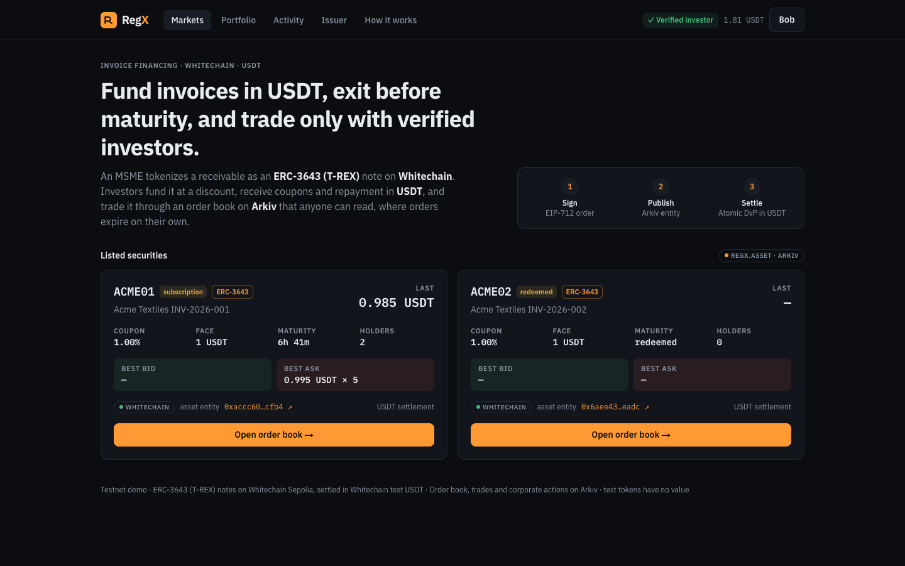
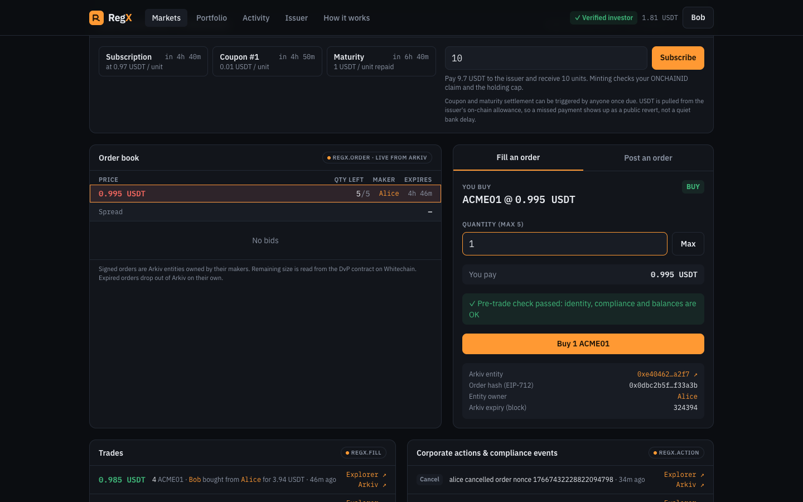
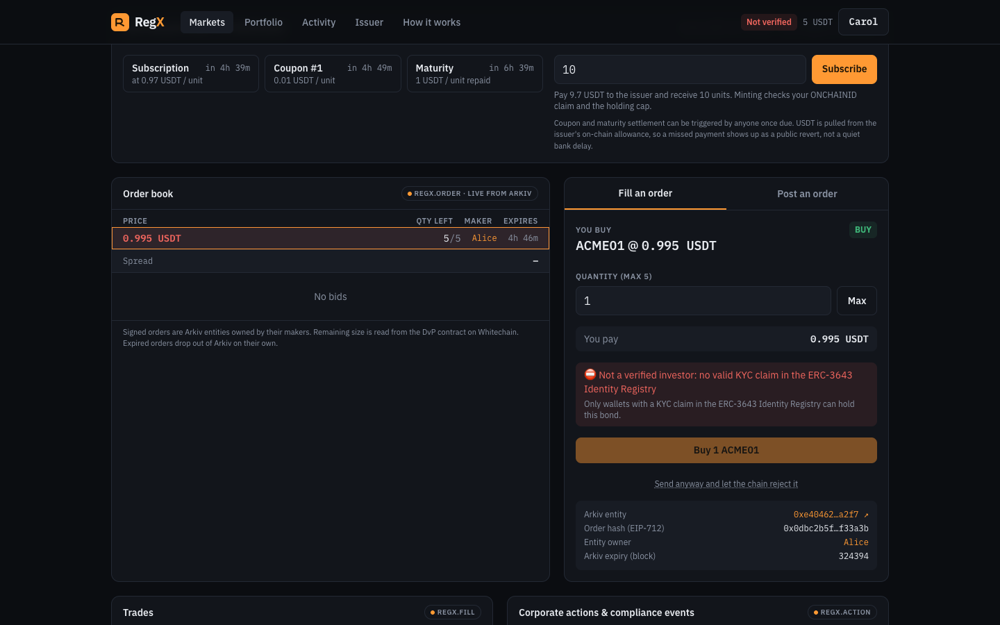
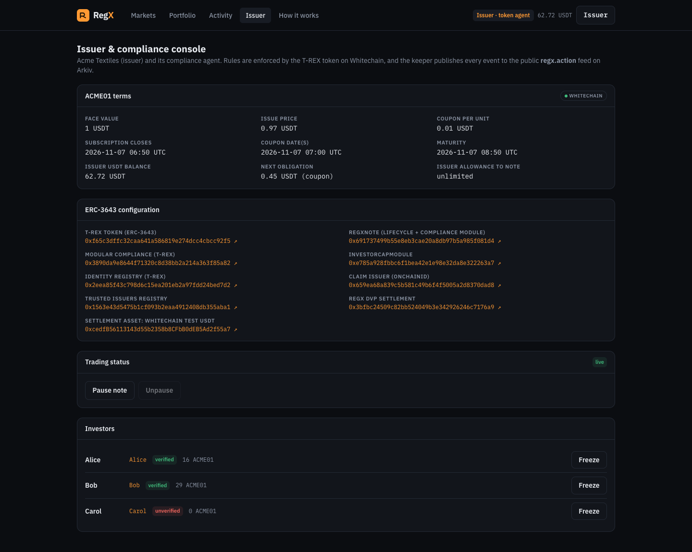
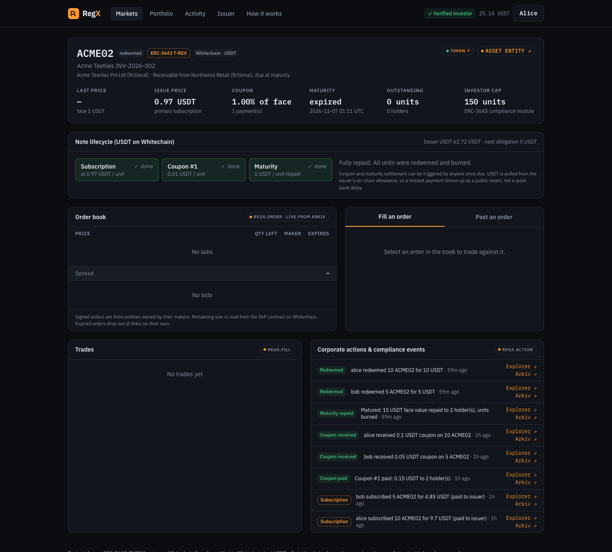
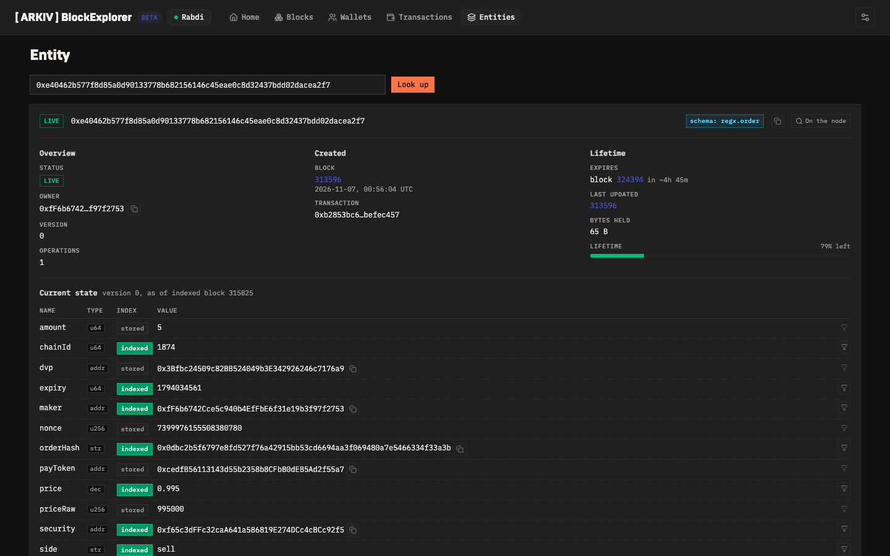

# RegX

**Invoice-backed notes you can fund in USDT, exit before maturity, and trade only with verified investors.**
ERC-3643 (T-REX) notes on **Whitechain**, settled in Whitechain test USDT, with a public order book and market history on **Arkiv**.

> Whitechain holds the money and enforces who may hold the note. Arkiv makes the market public and queryable, and stale orders expire on their own.

Built at **ETHGlobal Mumbai 2026** for:
- **Whitechain: Tokenize · Real World Finance on Whitechain**
- **Arkiv: Build on Arkiv (from scratch)**

**Why on-chain stablecoin settlement:** an invoice note is only as good as its cash leg. When subscription money, coupons and repayment
move in USDT inside the same contracts that enforce the transfer rules, an investor gets paid by code on the due date instead of waiting on
a bank transfer, a trade can't deliver the note without the cash (or the cash without the note), and a missed payment shows up as a public
on-chain revert rather than a quiet delay.

<!-- DEPLOYMENT:START -->
## Live on Whitechain Sepolia (chain 1874)

| Contract | Address (all verified on the explorer) |
|---|---|
| **ACME01**: T-REX Token (ERC-3643), trading until maturity | [`0xf65c3dffc32caa641a586819e274dcc4cbcc92f5`](https://explorer.testnet.whitechain.io/address/0xf65c3dffc32caa641a586819e274dcc4cbcc92f5) |
| ACME01 RegXNote (lifecycle + compliance module) | [`0x691737499b55e8eb3cae20a8db97b5a985f081d4`](https://explorer.testnet.whitechain.io/address/0x691737499b55e8eb3cae20a8db97b5a985f081d4) |
| ACME01 ModularCompliance / InvestorCapModule | [`0x3890da9e8644f71320c8d38bb2a214a363f85a82`](https://explorer.testnet.whitechain.io/address/0x3890da9e8644f71320c8d38bb2a214a363f85a82) / [`0xe785a928fbbc6f1bea42e1e98e32da8e322263a7`](https://explorer.testnet.whitechain.io/address/0xe785a928fbbc6f1bea42e1e98e32da8e322263a7) |
| **ACME02**: short-dated note, full lifecycle completed | [`0x42696162ed99138508542746c0a66e214d5475d7`](https://explorer.testnet.whitechain.io/address/0x42696162ed99138508542746c0a66e214d5475d7) (RegXNote [`0x326fdd596bf7cd8fd5b1a7289373db5b1e99deae`](https://explorer.testnet.whitechain.io/address/0x326fdd596bf7cd8fd5b1a7289373db5b1e99deae)) |
| T-REX IdentityRegistry | [`0x2eea85f43c798d6c15ea201eb2a97fdd24bed7d2`](https://explorer.testnet.whitechain.io/address/0x2eea85f43c798d6c15ea201eb2a97fdd24bed7d2) |
| ONCHAINID ClaimIssuer (KYC topic 1) | [`0x659ea68a839c5b581c49b6f4f5005a2d8370dad8`](https://explorer.testnet.whitechain.io/address/0x659ea68a839c5b581c49b6f4f5005a2d8370dad8) |
| TrustedIssuers / ClaimTopics / IdentityRegistryStorage | [`0x1563e43d5475b1cf093b2eaa4912408db355aba1`](https://explorer.testnet.whitechain.io/address/0x1563e43d5475b1cf093b2eaa4912408db355aba1) / [`0xd422dbade01fba80b938e2772bb368e9518ff60c`](https://explorer.testnet.whitechain.io/address/0xd422dbade01fba80b938e2772bb368e9518ff60c) / [`0x2badbb968b29076708f4dc6e8cd6899044e955a2`](https://explorer.testnet.whitechain.io/address/0x2badbb968b29076708f4dc6e8cd6899044e955a2) |
| **RegXDvP** | [`0x3bfbc24509c82bb524049b3e342926246c7176a9`](https://explorer.testnet.whitechain.io/address/0x3bfbc24509c82bb524049b3e342926246c7176a9) |
| Settlement asset: Whitechain test USDT | [`0xcedfB56113143d55b2358b8CFbB0dEB5Ad2f55a7`](https://explorer.testnet.whitechain.io/address/0xcedfB56113143d55b2358b8CFbB0dEB5Ad2f55a7) |

### USDT payments in the main flow (explorer links)

| Step | Party | Tx |
|---|---|---|
| Subscription: 30 units for **29.1 USDT** paid to the issuer | Alice → Acme | [0x1cca6c8e…](https://explorer.testnet.whitechain.io/tx/0x1cca6c8e035a63f013a219250ce02b5a6e5e503eaf5ce5b8a3fea1ef7744c61c) |
| Subscription: 10 units for 9.7 USDT | Bob → Acme | [0xf3ab83d9…](https://explorer.testnet.whitechain.io/tx/0xf3ab83d94e3dc3e05cb43d12fc77f09d6ad22fc5d32182f405ac97cc018f7845) |
| **Unverified subscriber rejected on-chain** | Carol | [0x0343498c…](https://explorer.testnet.whitechain.io/tx/0x0343498c82d986a4cfc44007c4bbec2555f282d4eaf39904f554b29e5cad82d6) |
| **Atomic DvP:** 10 units ↔ **9.9 USDT** in one tx (order read from Arkiv) | Bob ↔ Alice | [0xd277ba24…](https://explorer.testnet.whitechain.io/tx/0xd277ba24ad13601bb5f333c03349ee7097416adf0afea4d44b785258f338c956) |
| **Unverified buyer rejected on-chain**, USDT untouched | Carol | [0x252deb8e…](https://explorer.testnet.whitechain.io/tx/0x252deb8ed666fc26bd7f0ada491b44dd16868a67b15aecc546f118de868afbab) |
| ACME02 subscriptions | Alice, Bob | [0x11167655…](https://explorer.testnet.whitechain.io/tx/0x11167655abc95390be01a29ad5ec4394ccd633ebc41aeb51b7f622e1140ebe66) · [0x4f08b55c…](https://explorer.testnet.whitechain.io/tx/0x4f08b55c510df1b1994fed6ca6390dff72cd9b09ab877d0e0666a87efb9662a6) |
| **Coupon in USDT, auto-settled on the due date** by the keeper | Acme → holders | [0xb330abfe…](https://explorer.testnet.whitechain.io/tx/0xb330abfe3276c5ca1b5a8ca7184daa1b1ccc165bd4633add7270fc82bd952a7e) |
| **Maturity: 15 USDT face value repaid, units burned**, auto-settled | Acme → holders | [0x183c9dd7…](https://explorer.testnet.whitechain.io/tx/0x183c9dd7d56091f4f86aaf0380b732d51e114e58936095bb9ff226476503eb21) |

**Arkiv writers:** keeper [`0xee02FaA3ec03213c4a837a3F9Dc9D6F210ab74C5`](https://rabdi.explorer.arkiv.network/address/0xee02FaA3ec03213c4a837a3F9Dc9D6F210ab74C5) (assets, fills, actions); makers Alice [`0xfF6b6742Cce5c940b4EfFbE6f31e19b3f97f2753`](https://rabdi.explorer.arkiv.network/address/0xfF6b6742Cce5c940b4EfFbE6f31e19b3f97f2753) and Bob [`0xf3fE188e80ed94EFbDCB1B51e343200381d83DE3`](https://rabdi.explorer.arkiv.network/address/0xf3fE188e80ed94EFbDCB1B51e343200381d83DE3) (orders, owned by their own wallets).
**Run a query yourself:** `npm install && ARKIV_ACCESS_KEY=… npm run arkiv:query` prints the live book, trades and corporate actions straight from Arkiv ([`scripts/arkiv-query.ts`](scripts/arkiv-query.ts)).
**The order book query:** `select().from(OrderEntity).where(and(eq("security", addr("0xf65c3dffc32caa641a586819e274dcc4cbcc92f5")), eq("side","sell"), gt("expiry", u64(now)))).orderBy(asc("price"))`
<!-- DEPLOYMENT:END -->

`npm run wc:e2e` replays subscription, the Carol rejections, the Arkiv-sourced DvP fill and the keeper mirroring with assertions against
testnet. Everything in the tables above was also exercised through the web app (Bob subscribing and filling, Alice posting and cancelling,
Carol's forced fill reverting on-chain, the issuer freezing, unfreezing, pausing and unpausing).

## Screenshots

| | |
|---|---|
|  **Markets:** notes listed from Arkiv `regx.asset`, best bid/ask from the Arkiv book |  **Verified investor:** order book read from Arkiv, pre-trade check passes, atomic USDT DvP |
|  **Unverified investor:** ERC-3643 blocks Carol; "send anyway" reverts on-chain |  **Issuer:** terms, T-REX configuration, pause, freeze per investor |
|  **Full lifecycle:** subscription → coupon → maturity repaid in USDT, every step mirrored to Arkiv |  **Arkiv:** Alice's order entity, owned by her wallet, indexed fields, expiring with the order |

---

## The problem

Indian MSMEs have well over ₹10 lakh crore stuck in unpaid receivables. Invoice-discounting platforms let investors fund those invoices,
but **an investor can't exit before maturity**: every platform is a silo with its own KYC and its own order book. A tokenized note can't
trade on an open DEX either, because every holder has to be an eligible, verified investor. And the cash side (subscription, coupon,
repayment) still runs on bank rails, so the investor trusts the platform to pay on time.

## Parties

| Party | Does | In the app |
|---|---|---|
| **Issuer** (Acme Textiles, fictional MSME) and its compliance agent | Issues the note, sets terms, onboards investors, freezes/pauses, funds coupons and repayment through a USDT allowance | Issuer console |
| **Investors** Alice and Bob (verified) | Subscribe in USDT, post and fill orders, receive coupons and face value | Asset page, Portfolio |
| **Carol** (no KYC claim) | Shows what the rules block: she can browse, but subscriptions and trades to her revert on-chain | Any page |
| **Keeper** (anyone can run it) | Triggers due coupons and maturity, mirrors every event into Arkiv | `npm run wc:keeper` |

## Lifecycle

1. **Issue.** `RegXNote` + a T-REX `Token` are deployed with terms: face 1 USDT, issue price 0.97 USDT, coupon 0.01 USDT per unit,
   subscription window, coupon date(s), maturity. The token is wired to a shared T-REX Identity Registry and its own Modular Compliance.
2. **Verify.** The compliance agent deploys an ONCHAINID for each investor and adds a KYC claim (topic 1) signed by the trusted
   ClaimIssuer. No personal data goes on-chain or to Arkiv.
3. **Subscribe (primary).** `RegXNote.subscribe(units)` pulls `units × issuePrice` USDT from the investor **straight to the issuer**,
   then mints the units. The mint runs the ERC-3643 checks, so an unverified wallet's subscription reverts and no USDT moves.
4. **Trade (secondary).** Makers sign EIP-712 orders and publish them as `regx.order` entities on Arkiv from their own wallets. Takers
   read the book from Arkiv and call `RegXDvP.fill()`: USDT and units swap **atomically**, and the token's identity, freeze, pause and
   compliance checks run inside that transaction.
5. **Coupon.** After each coupon date, anyone can call `payCoupon(i)`. The contract pays `units × couponPerUnit` USDT to every holder
   from the issuer's allowance. The keeper calls it automatically.
6. **Maturity.** After maturity, anyone can call `settleMaturity()`. It repays face value in USDT to every holder and burns the units.
   The note is then closed. The keeper calls this automatically too.

## Rules enforced in the contracts

- **Identity:** every mint and transfer needs `IdentityRegistry.isVerified(to)`: an ONCHAINID with a valid KYC claim from a trusted issuer.
- **Holding cap:** `InvestorCapModule` limits any wallet to 150 units of a note.
- **Lifecycle windows** (`RegXNote` is itself a T-REX compliance module): minting only during subscription, transfers only before
  maturity. Only token agents (the note contract and the issuer) can mint or burn, and the note burns units only when it repays them.
- **Issuer controls:** `setAddressFrozen` (a frozen wallet's orders can't fill) and `pause` (all transfers stop).
- **Settlement:** DvP is all-or-nothing. If the units can't move, the USDT doesn't move either. Orders are EIP-712 signed with a nonce,
  expiry, partial fills and on-chain cancel.

`RegXDvP.checkFill()` runs the same checks as a view, so the UI explains a rejection (*not verified*, *frozen*, *paused*, *cap*, *balance*,
*allowance*) before anyone pays gas. The "send anyway" link skips it, so you can watch the chain reject the trade itself.

## Architecture

```
          ┌──────────────────────── Web app (Next.js · wagmi · viem) ─────────────────────────┐
          │ Markets │ Asset: lifecycle + order book + trade │ Portfolio │ Activity │ Issuer   │
          └────┬───────────────────────────────────┬──────────────────────────────────────────┘
   createEntity│ select().from(schema).where()     │ subscribe · fill · checkFill · approve
               ▼                                   ▼
┌───────────────────────────────┐     ┌────────────────────────────────────────────────────────┐
│ Arkiv Rabdi (7794095)         │     │ Whitechain Sepolia (1874)                              │
│  regx.order   ← maker wallets │     │  T-REX Token (ERC-3643) per note                       │
│  regx.fill    ← keeper        │     │    ├─ IdentityRegistry ── ClaimTopics (1 = KYC)        │
│  regx.action  ← keeper        │◄────│    │     └─ TrustedIssuers → ClaimIssuer (ONCHAINID)   │
│  regx.asset   ← keeper (sync) │keeper    └─ ModularCompliance                                │
└───────────────────────────────┘     │          ├─ RegXNote (lifecycle module + USDT terms)   │
                                      │          └─ InvestorCapModule                          │
                                      │  RegXDvP (EIP-712 orders, atomic DvP)                  │
                                      │  USDT 0xcedf…55a7 (Whitechain test stablecoin)         │
                                      └────────────────────────────────────────────────────────┘
```

**Source of truth:** ownership, balances, eligibility, payments and filled amounts live on Whitechain. Intent (open orders), terms, trade
prints and corporate actions live on Arkiv. The UI shows `order.amount − RegXDvP.filled(orderHash)` read from Whitechain, so Arkiv order
entities never need patching.

## Repository

| Path | What |
|---|---|
| `contracts/src/RegXNote.sol` | note lifecycle (subscribe, coupons, maturity in USDT) and a T-REX compliance module for the lifecycle windows |
| `contracts/src/RegXDvP.sol` | EIP-712 order settlement, partial fills, cancel by nonce, `checkFill` pre-trade view |
| `contracts/src/compliance/InvestorCapModule.sol` | ERC-3643 compliance module (holding cap) |
| `contracts/test/` | 24 Foundry tests against the **real T-REX Token + ONCHAINID** contracts |
| `shared/src/arkiv.ts` | Arkiv schemas and every query the app uses |
| `shared/src/whitechain.ts` | chain config, explorer links, deployment loader |
| `scripts/wc/deploy.ts` | resumable deployment: T-REX stack, onboarding, USDT distribution, notes (`--note` issues another) |
| `scripts/wc/keeper.ts` | auto-settles due coupons/maturity; mirrors events to Arkiv `regx.fill` / `regx.action` (idempotent) |
| `scripts/wc/lifecycle.ts` | subscribe, coupon, mature, freeze/unfreeze, pause/unpause, KYC revoke, onboard, status |
| `scripts/wc/e2e.ts`, `verify.ts`, `seed-orders.ts`, `sync-assets.ts` | testnet assertions, explorer verification, demo orders, asset sync |
| `scripts/hedera/` | the first version of the venue (Hedera ATS), kept for reference |
| `web/` | Next.js app |
| `arkiv/` | Arkiv judging files: schema, why, how, reach, friction |
| `WHITECHAIN_FEEDBACK.md` | builder feedback for Whitechain |

## Run it

Prereqs: Node 22.10+, Foundry.

```bash
npm install
cd contracts && npm install && forge build && forge test && cd ..
npm run abis

cp .env.example .env     # demo keys + ARKIV_ACCESS_KEY
# fund DEPLOYER with WBT (https://faucet.testnet.whitechain.io), ~100 test USDT and some tGLM (https://hub.arkiv.network/faucet)
npm run wc:deploy        # resumable; writes shared/deployments/whitechain-sepolia.json
npm run wc:verify        # Blockscout verification
npm run wc:seed          # Alice/Bob orders on Arkiv
npm run wc:keeper        # leave running: auto-settlement + Arkiv mirroring

echo "NEXT_PUBLIC_ARKIV_ACCESS_KEY=..." > web/.env.local
npm run web              # http://localhost:3000
```

**Wallets in the browser.** Use MetaMask (add Whitechain Sepolia, chain 1874, RPC `https://rpc.testnet.whitechain.io`; the app also
switches to Arkiv Rabdi when you post an order). For local testing and demo recording there is also a **test wallet**: under `npm run web`
on localhost, open any page with `?as=alice` (or `issuer`, `bob`, `carol`, `off`) or use the switcher in the bottom-right corner. It
signs server-side with that persona's key from `.env`. The keys never reach the browser, and the route returns 404 outside `next dev`.

Lifecycle from the CLI:

```bash
npm run wc:note -- --sub 10m --coupon 14m --maturity 18m   # fresh short-dated note for a demo
npm run wc:life -- subscribe alice 30
npm run wc:life -- coupon            # permissionless once due (the keeper does this on its own)
npm run wc:life -- mature
npm run wc:life -- freeze alice | unfreeze alice | pause | unpause
npm run wc:life -- onboard 0xYourWallet   # ONCHAINID + KYC claim + Identity Registry
npm run wc:seed -- --flash           # 3-minute order: watch it expire off the book on its own
npm run wc:life -- status
npm run wc:e2e
```

## Demo script (≤ 4 min)

1. **Issuer:** Issuer console shows the terms, the T-REX contracts and the investor list. Alice and Bob are verified, Carol is not.
2. **Investor subscribes:** Bob subscribes on the asset page. The USDT goes to the issuer and the units are minted (explorer link in the toast).
3. **Trade:** Alice posts a sell order and the `regx.order` entity appears on the Arkiv explorer. Bob fills it in one atomic USDT DvP tx,
   and the fill appears in `regx.fill`.
4. **Rules:** Carol tries to subscribe and to buy. The pre-trade check names the reason, "send anyway" **reverts on-chain**, and her USDT
   is untouched. The issuer freezes Alice and Bob's pre-trade check flips to *frozen*.
5. **Lifecycle:** on a short-dated note, the keeper pays the coupon and then repays face value in USDT. The timeline turns green and the
   Arkiv actions feed shows each payment.
6. **Expiry:** a 2-minute order disappears from the book with no transaction.

## Limitations

- **Testnet only:** test USDT and test WBT, fictional issuer and receivable. No legal wrapper, servicing or default handling for the underlying invoice.
- **Off-chain receivable:** the note's terms reference the invoice. Nothing on-chain proves the receivable exists or that the obligor paid.
- **Issuer default isn't modelled:** if the issuer's USDT balance or allowance is short, `payCoupon` / `settleMaturity` revert publicly
  and can be retried, but there is no waterfall, grace period or partial payment.
- **Unbounded holder loops:** coupon and maturity pay every holder in one transaction. That's fine for a demo-sized cap table. A production
  version would use pull-based claims or batching.
- **KYC is a demo desk:** the compliance agent's key signs claims from a script. There is no real identity provider behind it.
- **Arkiv order book is public but not a matching engine:** takers pick an order. There's no price-time matching across makers.
- **One keeper:** anyone can run it and it is idempotent, but there is no incentive or redundancy beyond that.

## AI disclosure

This project was built with substantial help from an AI coding assistant (Claude Code): research into the T-REX, ONCHAINID, Whitechain
and Arkiv SDK sources, contract and test code, scripts, the web app and documentation. All on-chain deployments, transactions and Arkiv
entities listed above were produced by running this code on testnet.

## License

[MIT](LICENSE) for RegX code. T-REX (GPL-3.0) and ONCHAINID (GPL-3.0) contracts are used as npm dependencies.
